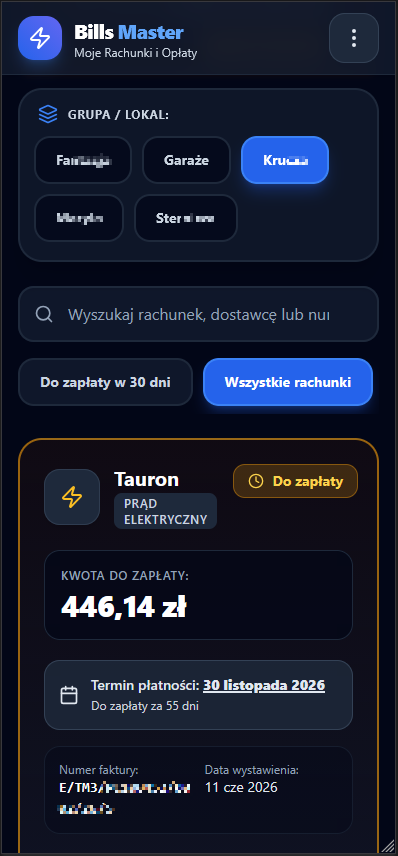
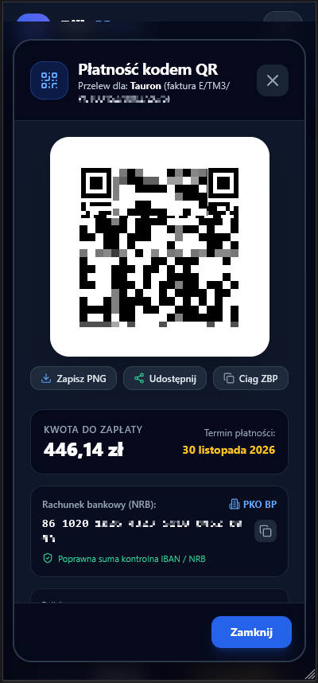

<div align="center">

# ⚡ BillsMaster
### Self-Hosted Utility Billing & Payment Center

[](docker-compose.yml)
[](https://www.typescriptlang.org/)
[](https://react.dev/)
[](https://fastify.dev/)
[](https://playwright.dev/)
[](LICENSE)

<p align="center">
  <b>BillsMaster</b> automatically collects, tracks, and archives all your household and business utility bills (electricity, gas, water, housing, internet, TV) in one centralized, self-hosted web app with mobile-friendly Polish banking QR payments.
</p>

[Key Features](#-key-features) •
[Screenshots](#-screenshots) •
[Supported Providers](#-supported-providers) •
[Quickstart](#-quickstart-with-docker-compose) •
[Architecture](#-architecture) •
[Security](#-security--encryption)

</div>

---

## 📱 Screenshots

<div align="center">
  <table>
    <tr>
      <td align="center" width="50%">
        
        <br />
        <b>Mobile Dashboard</b>
        <br />
        <i>Multi-property filters (Lokale / Grupy), quick search, due countdowns & invoice cards</i>
      </td>
      <td align="center" width="50%">
        
        <br />
        <b>Instant QR Code Payment (Standard ZBP)</b>
        <br />
        <i>Scan & pay with any Polish banking app (mBank, PKO BP, Santander, ING, Millennium, etc.)</i>
      </td>
    </tr>
  </table>
</div>

---

## ✨ Key Features

* 🤖 **Headless Web Scraping via Playwright:**
  * Fully automated logins to Polish utility eBOK portals using headless Chromium.
  * Preserves authenticated browser session cookies to minimize CAPTCHAs and repeated logins.
  * Downloads original high-resolution PDF invoices straight into an encrypted local archive.

* 📲 **ZBP Standard QR Payments (Płatność kodem QR):**
  * Generates compliant Polish Banking Association (**ZBP — Związek Banków Polskich**) payment QR codes.
  * Instant scan & pay in mobile banking apps (PKO BP, mBank, Santander, ING, Millennium, Pekao, Alior, etc.).
  * Validates IBAN / NRB modulo-97 checksums and detects bank names in real-time.
  * Export options: Download PNG, native Web Share, or copy raw ZBP transfer string.

* 🏠 **Multi-Property Grouping (Grupy / Lokale):**
  * Organize accounts and bills across multiple locations (e.g. *Mieszkanie*, *Garaże*, *Domek letniskowy*, *Firma*).
  * Filter dashboards and calculate due totals per property with a single click.

* 📧 **Gmail / Google Apps Script Ingestion:**
  * Built-in Google Apps Script webhook integration for bills received via email (Canal+, Orange, Play, etc.).
  * Automatically extracts payment amounts, due dates, IBANs, and attachments from incoming emails.

* 🔄 **Live Sync & Real-Time Monitoring:**
  * High-performance background queueing powered by **BullMQ** & **Redis**.
  * Real-time sync progress, steps, and percentage indicators streamed to the UI via **WebSockets**.
  * Smart Error Classifier diagnostics with actionable hints in Polish.

* 🌙 **Installable Progressive Web App (PWA):**
  * Modern, dark-first UI built with React 19, Vite, and Tailwind CSS.
  * Installable directly on Android, iOS, Windows, and macOS home screens.
  * Integrated in-app PDF invoice viewer with page navigation and zoom.

* 🔒 **Military-Grade Security:**
  * Portal passwords encrypted at rest with authenticated **AES-256-GCM** envelope encryption.
  * User credentials hashed with **bcrypt**.
  * Session authorization secured with HTTP-only, secure JWT cookies.

---

## 🔌 Supported Providers

| Provider | Type | Category | Method | Status |
| :--- | :--- | :--- | :--- | :---: |
| **Tauron eBOK** | Electricity (`moj.tauron.pl`) | `ENERGY` | Playwright Scraper | ✅ Production |
| **myORLEN (PGNiG)** | Gas (`ebok.myorlen.pl`) | `GAS` | Playwright Scraper | ✅ Production |
| **AQUA Bielsko-Biała** | Water & Sewage (`ebok.aqua.com.pl`) | `WATER` | Playwright Scraper | ✅ Production |
| **Netia Online** | Internet & Fiber (`netiaonline.pl`) | `INTERNET` | Playwright Scraper | ✅ Production |
| **Euro-lan BOK** | Local ISP (`bok.euro-lan.pl`) | `INTERNET` | Playwright Scraper | ✅ Production |
| **e-kartoteka** | Housing Community / Spółdzielnia | `HOUSING` | Playwright API / Scraper | ✅ Production |
| **Email Ingestion (GAS)** | Canal+, Orange, Play, T-Mobile, Vectra | `TELECOM` / `OTHER` | Webhook (Gmail AppScript) | ✅ Production |
| **Mock Provider** | Development & Demo Sandbox | `OTHER` | Synthetic PDF Generator | ✅ Testing |

---

## 🚀 Quickstart with Docker Compose

### 1. Clone the repository
```bash
git clone https://github.com/krzysztof-lorenc/BillsMaster.git
cd BillsMaster
```

### 2. Configure Environment
Copy [.env.example](.env.example) to `.env`:
```bash
cp .env.example .env
```

Generate a secure 64-character hex key (32 bytes) for `MASTER_ENCRYPTION_KEY`:
```bash
node -e "console.log(require('crypto').randomBytes(32).toString('hex'))"
```

Fill in `MASTER_ENCRYPTION_KEY` and a random `JWT_SECRET` in `.env`:
```env
MASTER_ENCRYPTION_KEY=your_generated_64_hex_key_here
JWT_SECRET=your_jwt_secret_token_here
PUBLIC_URL=http://localhost:3000
```

### 3. Launch Services
```bash
docker compose up -d --build
```

The stack will start 4 Docker containers:
* `billsmaster-frontend` (Port **3000**) — React 19 SPA served via Nginx with API proxy
* `billsmaster-backend` (Port **3005**) — Fastify Node.js API + Playwright Chromium scraper
* `billsmaster-postgres` (Port **5433** internal 5432) — PostgreSQL 16 database
* `billsmaster-redis` (Port **6379**) — Redis 7 queue broker for BullMQ

### 4. First-Run Setup
1. Open [http://localhost:3000](http://localhost:3000) in your browser.
2. Complete the **First-Run Setup Wizard** to register your Administrator account.
3. Install the app on your mobile device or desktop via the **Install App** button in the top navigation bar.
4. Navigate to **Administration -> Portale dostawców** to add your utility portal accounts.

---

## 🏗️ Architecture

```
                       ┌────────────────────────────────────────┐
                       │          React 19 PWA Client           │
                       │   (Tailwind CSS, ZBP QR, PDF Viewer)   │
                       └───────────────────┬────────────────────┘
                                           │ HTTP / WS
                                           ▼
┌───────────────────────────────────────────────────────────────────────────────┐
│                      Nginx Reverse Proxy & Static Server                      │
└──────────────────────────────────────┬────────────────────────────────────────┘
                                       │
                                       ▼
┌───────────────────────────────────────────────────────────────────────────────┐
│                           Fastify REST & WS Backend                           │
│  ┌───────────────────────┐ ┌───────────────────────┐ ┌─────────────────────┐  │
│  │   Auth & Accounts     │ │   AES-256-GCM Crypto  │ │  MailScript Ingest  │  │
│  └───────────────────────┘ └───────────────────────┘ └─────────────────────┘  │
└──────────────┬───────────────────────────┬────────────────────────────┬───────┘
               │                           │                            │
               ▼                           ▼                            ▼
┌───────────────────────────┐ ┌──────────────────────────┐ ┌────────────────────┐
│       PostgreSQL 16       │ │      Redis 7 Queue       │ │ Storage Archive    │
│  (Prisma ORM data models) │ │    (BullMQ Job Broker)   │ │ (PDFs & Sessions)  │
└───────────────────────────┘ └────────────┬─────────────┘ └────────────────────┘
                                           │
                                           ▼
                              ┌──────────────────────────┐
                              │  BullMQ Scraper Workers  │
                              │   (Playwright Chromium)  │
                              └──────────────────────────┘
```

---

## 🛠️ Monorepo Structure

```
BillsMaster/
├── docker-compose.yml              # Multi-container orchestration
├── redeploy.sh                     # Automated build, restart & health verification script
├── .env.example                    # Environment variable template
│
├── apps/
│   ├── backend/                    # Fastify API, Prisma ORM, Playwright Scrapers
│   │   ├── prisma/schema.prisma    # Database schema
│   │   ├── src/
│   │   │   ├── controllers/        # REST route handlers
│   │   │   ├── providers/          # Modular IBillProvider implementations
│   │   │   ├── queue/              # BullMQ queue producers and consumers
│   │   │   ├── security/           # AES-256-GCM encryption & bcrypt hashing
│   │   │   └── services/           # Business logic & 12-month retention cleaner
│   │   └── storage/                # Persistent volumes for invoices and sessions
│   │
│   └── frontend/                   # React 19, Vite, Tailwind CSS, Lucide icons
│       ├── public/                 # PWA icons and provider SVGs
│       └── src/
│           ├── components/         # QR modal, PDF viewer, Fullscreen sync modal
│           ├── lib/                # ZBP QR generator, API client
│           └── pages/              # Dashboard, Bills, Portals, Groups, Users
│
├── docs/
│   └── screenshots/                # Application screenshots
└── packages/
    └── shared-types/               # Shared TypeScript interfaces across front/back
```

---

## 🧪 Testing

```bash
# Run unit and integration tests (96+ automated tests)
npm run test:backend

# Run frontend type-checking
npm run typecheck --workspace=frontend

# Verify container deployment and health
./redeploy.sh verify
```

---

## 🔐 Security & Encryption

* **Portal Credentials Encryption:** Utility portal logins and passwords stored in PostgreSQL are encrypted using **AES-256-GCM** with a unique Initialization Vector (IV) and authentication tag per record. Even with direct database read access, secrets cannot be decrypted without the host machine's `MASTER_ENCRYPTION_KEY`.
* **Zero Telemetry / 100% Self-Hosted:** No billing information, credentials, or PDFs ever leave your private server.
* **Network Isolation:** Database and Redis services run on internal Docker networks without exposing ports to public interfaces in production.

---

## 📄 License

This project is licensed under the [MIT License](LICENSE).
